# Parcial: LAN con DHCP, NAT, SNMP + Zabbix, SSH, AAA/RADIUS y Hardening CIS

### Arlene Fernández Herrera · Matrícula: 2025-0730

**Seguridad de Redes · ITLA**

---

## Video Demostrativo

**[▶ Ver video de demostración](https://youtu.be/ID_DEL_VIDEO)**

---

## Contenido

1. [Propósito](#1-propósito)
2. [TopoloEa y direccionamiento](#2-topoloEa-y-direccionamiento)
3. [Implementación](#3-implementación)
4. [Cumplimiento de requisitos](#4-cumplimiento-de-requisitos)
5. [Estructura del repositorio](#5-estructura-del-repositorio)

---

## 1. Propósito

Esta práctica implementa una red LAN con un router y un switch Cisco, un servidor Windows Server con Active Directory y NPS (RADIUS) y un servidor Zabbix en Linux. Cubre:

* Direccionamiento basado en la matrícula, hostname en todos los equipos y conectividad en la LAN.
* **DHCP** en el router y salida al ISP con **ruta por defecto y NAT**.
* **SNMP de solo lectura** en el router, monitoreado desde **Zabbix**.
* Acceso administrativo por **SSH** con usuario local de contraseña cifrada, sin Telnet.
* **AAA con RADIUS (NPS)** en el router, con reEstros de accesos exitosos y fallidos.
* **Hardening CIS** del switch con un script que genera un informe posterior a la aplicación.

---

## 2. TopoloEa y direccionamiento

La LAN sale de `10.7.30.0/24` (matrícula 0730). No se usa la primera IP utilizable: el router usa la segunda (`10.7.30.2`). La red del ISP es `202.50.73.0/24` (NAT de VMware, VMnet8).


```
                  ISP · NAT de VMware (VMnet8)
                  202.50.73.0/24 · GW 202.50.73.2
                              │
                       E0/1: 202.50.73.10
                      ┌───────┴───────┐
                      │      R1       │
                      │  Router Cisco │
                      └───────┬───────┘
                       E0/0: 10.7.30.2
                              │
                         E0/0 │
                      ┌───────┴───────┐
                      │      SW1      │
                      │ IOSvL2 · Vlan10│
                      │  10.7.30.3    │
                      └─┬─────┬─────┬─┘
                    E0/1│ E0/2│ E0/3│
                 ┌──────┘     │     └─────────┐
          ┌──────┴─────┐ ┌────┴───────┐ ┌─────┴──────┐
          │  PC-USER   │ │  AAA-SRV   │ │  ZBX-SRV   │
          │   DHCP     │ │ 10.7.30.4  │ │10.7.30.253 │
          │            │ │ AD DS + NPS│ │   Zabbix   │
          └────────────┘ └────────────┘ └────────────┘

  SNMP v2c (UDP 161):   ZBX-SRV ───► R1
  RADIUS (UDP 1812/1813): R1 ───► AAA-SRV
  SSH (TCP 22):         AAA-SRV / ZBX-SRV ───► R1 y SW1
```

### 2.1 Dispositivos

| Dispositivo | Hostname | Interfaz | IP | Máscara | Gateway | Método |
|---|---|---|---|---|---|---|
| Router Cisco | `R1` | E0/0 | 10.7.30.2 | /24 | — | Estática |
| Router Cisco | `R1` | E0/1 | 202.50.73.10 | /24 | 202.50.73.2 | Estática |
| Switch Cisco IOSvL2 | `SW1` | Vlan10 | 10.7.30.3 | /24 | 10.7.30.2 | Estática |
| Windows Server 2022 | `AAA-SRV` | Ethernet0 | 10.7.30.4 | /24 | 10.7.30.2 | Estática |
| Servidor Zabbix (Ubuntu 24.04) | `ZBX-SRV` | ens33 | 10.7.30.253 | /24 | 10.7.30.2 | DHCP (reserva) |
| PC de usuarios (Windows 10) | `PC-USER` | Ethernet | 10.7.30.10 – .200 | /24 | 10.7.30.2 | DHCP |

### 2.2 Puertos del switch

| Puerto | VLAN | Conectado a |
|---|---|---|
| E0/0 | 10 | R1 `E0/0` |
| E0/1 | 10 | PC-USER |
| E0/2 | 10 | AAA-SRV |
| E0/3 | 10 | ZBX-SRV |

### 2.3 Parámetros de servicios

| Servicio | Parámetro | Valor |
|---|---|---|
| DHCP | Rango dinámico | `10.7.30.10 – 10.7.30.200` |
| DHCP | Excluidos | `10.7.30.1 – .9` y `10.7.30.201 – .254` |
| DHCP | Reserva | `10.7.30.253` para ZBX-SRV (por MAC) |
| DHCP | DNS | `8.8.8.8`, `8.8.4.4` |
| SNMP | Versión / comunidad | SNMPv2c / `zbx-ro-0730` (solo lectura) |
| SNMP | Origen permitido | Solo `10.7.30.253` |
| RADIUS | Servidor / puertos | `10.7.30.4` / UDP 1812 y 1813 |
| Active Directory | Dominio | `itla.local` (NetBIOS `ITLA`) |
| Active Directory | Grupo y usuario | `Admins-Red` / `user-admin` |
| SSH | Usuario local | `admin-local` (nivel 15, contraseña cifrada con `secret`) |

---

## 3. Implementación

### 3.1 Red virtual en VMware

Red NAT `VMnet8`: subred `202.50.73.0/24`, gateway NAT `202.50.73.2`. Cada máquina virtual (AAA-SRV, ZBX-SRV y PC-USER) usa su propia red **Host-only** sin DHCP de VMware, enlazada a PNETLab con un nodo Cloud, y entra a `SW1` por un solo cable. Una nube adicional, `Nube-ISP`, conecta `E0/1` de `R1` a `VMnet8`.

### 3.2 Switch SW1: red base

```bash
enable
configure terminal

hostname SW1
no ip domain-lookup
ip domain-name itla.local
spanning-tree mode rapid-pvst

vlan 10
 name LAN
exit

interface range Ethernet0/0 - 3
 switchport mode access
 switchport access vlan 10
 spanning-tree portfast
 no shutdown
exit

interface Vlan10
 description Gestion
 ip address 10.7.30.3 255.255.255.0
 no shutdown
exit

ip default-gateway 10.7.30.2

end
write memory
```

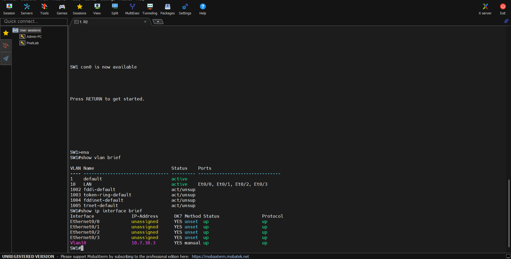

### 3.3 Router R1: interfaces, DHCP, ruta por defecto y NAT

```bash
enable
configure terminal

hostname R1
no ip domain-lookup
ip domain-name itla.local

interface Ethernet0/0
 description LAN
 ip address 10.7.30.2 255.255.255.0
 ip tcp adjust-mss 1420
 ip nat inside
 no shutdown
exit

interface Ethernet0/1
 description ISP
 ip address 202.50.73.10 255.255.255.0
 ip nat outside
 no shutdown
exit

ip dhcp excluded-address 10.7.30.1 10.7.30.9
ip dhcp excluded-address 10.7.30.201 10.7.30.254

ip dhcp pool LAN-POOL
 network 10.7.30.0 255.255.255.0
 default-router 10.7.30.2
 dns-server 8.8.8.8 8.8.4.4
 lease 1
exit

ip access-list standard NAT-LAN
 permit 10.7.30.0 0.0.0.255
exit

ip nat inside source list NAT-LAN interface Ethernet0/1 overload
ip route 0.0.0.0 0.0.0.0 202.50.73.2

end
write memory
```

Verificación:

```bash
show ip interface brief
show ip dhcp pool
show ip route
```

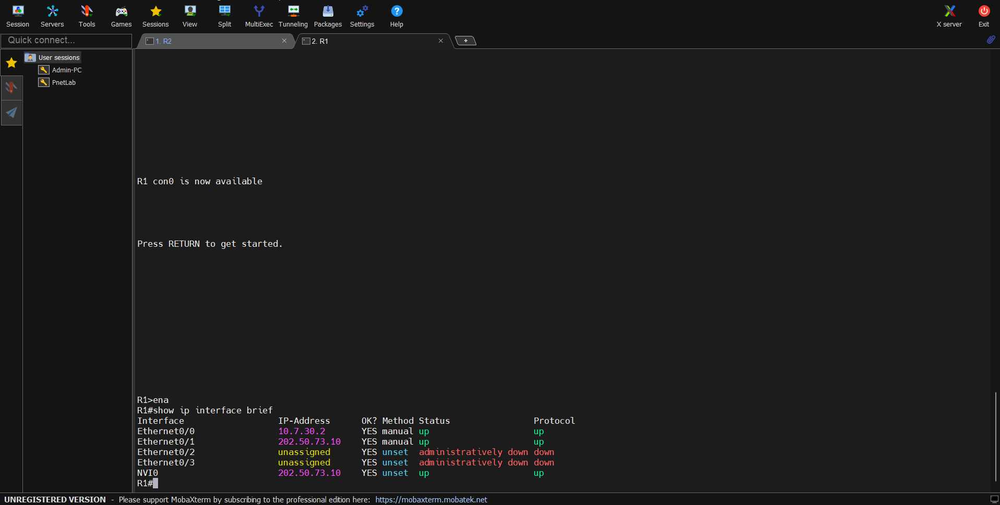

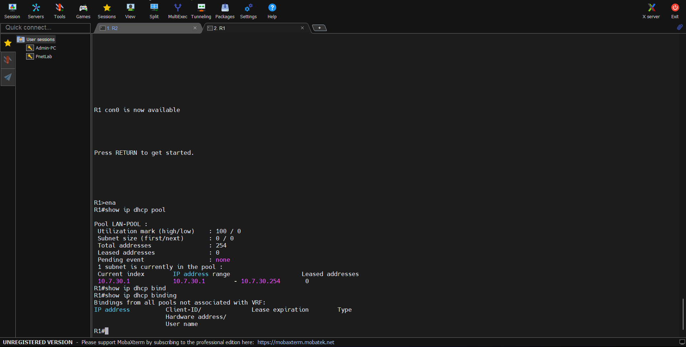

### 3.4 Servidor AAA-SRV: Active Directory y NPS

En PowerShell como administrador.

**Red y nombre:**

```powershell
New-NetIPAddress -InterfaceAlias "Ethernet0" -IPAddress 10.7.30.4 -PrefixLength 24 -DefaultGateway 10.7.30.2
Set-DnsClientServerAddress -InterfaceAlias "Ethernet0" -ServerAddresses 10.7.30.4
Set-NetIPInterface -InterfaceAlias "Ethernet0" -NlMtuBytes 1460
Rename-Computer -NewName "AAA-SRV" -Restart
```

**Active Directory, grupo y usuario:**

```powershell
Install-WindowsFeature AD-Domain-Services -IncludeManagementTools
Install-ADDSForest -DomainName "itla.local" -DomainNetbiosName "ITLA" -InstallDns -SafeModeAdministratorPassword (ConvertTo-SecureString "Dsrm-Lab-2026!" -AsPlainText -Force) -Force
```

Tras el reinicio, iniciar sesión con `ITLA\Administrator`:

```powershell
New-ADGroup -Name "Admins-Red" -GroupScope Global -GroupCategory Security
$pw = ConvertTo-SecureString "Lab12345!" -AsPlainText -Force
New-ADUser -Name "user-admin" -SamAccountName "user-admin" -UserPrincipalName "user-admin@itla.local" -AccountPassword $pw -Enabled $true -PasswordNeverExpires $true
Add-ADGroupMember -Identity "Admins-Red" -Members "user-admin"
```

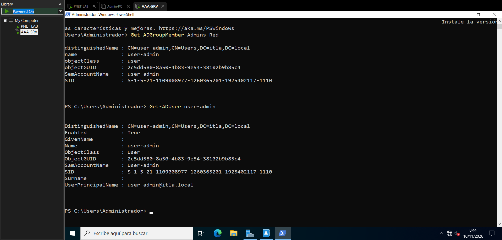

**NPS: instalación, cliente RADIUS y firewall:**

```powershell
Install-WindowsFeature NPAS -IncludeManagementTools
netsh nps add reEsteredserver
New-NpsRadiusClient -Name "R1" -Address "10.7.30.2" -SharedSecret "R4dius-Rtr-2026!"

Get-NetFirewallPortFilter -Protocol UDP | Where-Object { $_.LocalPort -in "1812","1813","1645","1646" } | Get-NetFirewallRule | Disable-NetFirewallRule
New-NetFirewallRule -DisplayName "RADIUS-R1" -Direction Inbound -Protocol UDP -LocalPort 1812,1813 -RemoteAddress 10.7.30.2 -Action Allow
```

**Política de red (GUI):** `Administrador del servidor → Herramientas → Servidor de directivas de redes → NPS (local) → Directivas → Directivas de red → clic derecho → Nueva`

| Campo | Valor |
|---|---|
| Nombre de la directiva | `Cisco-Admins` |
| Tipo de servidor de acceso a la red | `Sin especificar` |
| Condición: Grupos de Windows | `ITLA\Admins-Red` |
| Permiso de acceso | `Acceso concedido` |
| Métodos de autenticación | Solo **Autenticación sin cifrar (PAP, SPAP)** |
| Atributo estándar **Service-Type** | `LoEn` (quitar `Framed-Protocol` y el `Service-Type` por defecto) |
| Atributo del proveedor **Cisco-AV-Pair** | `shell:priv-lvl=15` |

La política `Cisco-Admins` debe quedar por encima de las dos políticas predeterminadas (clic derecho → **Subir**).

**ReEstro de eventos de NPS:** `NPS (local) → clic derecho → Propiedades → General` y marcar **Solicitudes de autenticación rechazadas** y **Solicitudes de autenticación correctas**. Después:

```powershell
auditpol /set /subcategory:"{0CCE9243-69AE-11D9-BED3-505054503030}" /success:enable /failure:enable
```

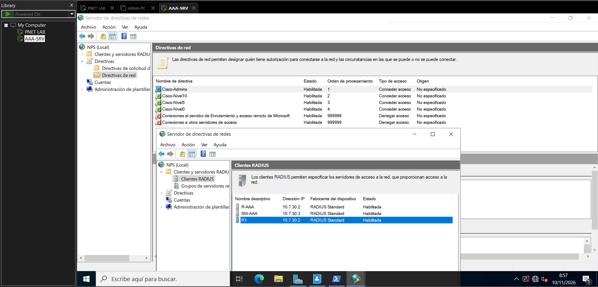

### 3.5 Servidor Zabbix (ZBX-SRV)

**Reserva DHCP en el router.** Obtener la MAC en Ubuntu:

```bash
ip -br link show ens33
```

El identificador de cliente es `01` seguido de la MAC (para `00:0c:29:6f:dc:05` es `0100.0c29.6fdc.05`). En el router, con la MAC real:

```bash
configure terminal

ip dhcp pool ZBX-RESERVA
 host 10.7.30.253 255.255.255.0
 client-identifier 0100.0c29.6fdc.05
 default-router 10.7.30.2
 dns-server 8.8.8.8 8.8.4.4
exit

end
write memory
```

**Red del servidor** (`/etc/netplan/50-cloud-init.yaml`):

```yaml
network:
  version: 2
  ethernets:
    ens33:
      dhcp4: true
      dhcp-identifier: mac
      mtu: 1460
```

```bash
sudo hostnamectl set-hostname zbx-srv
sudo netplan apply
ip -4 addr show ens33
ping -c 3 8.8.8.8
```

**Instalación de Zabbix 7.0 LTS** (script: [`scripts/zabbix-instalacion.sh`](scripts/zabbix-instalacion.sh)):

```bash
wget https://repo.zabbix.com/zabbix/7.0/ubuntu/pool/main/z/zabbix-release/zabbix-release_7.0-2+ubuntu24.04_all.deb
sudo dpkg -i zabbix-release_7.0-2+ubuntu24.04_all.deb
sudo apt update
sudo apt install zabbix-server-mysql zabbix-frontend-php zabbix-apache-conf zabbix-sql-scripts zabbix-agent snmp mariadb-server -y
sudo systemctl enable --now mariadb

sudo mysql -uroot -e "
  CREATE DATABASE zabbix CHARACTER SET utf8mb4 COLLATE utf8mb4_bin;
  CREATE USER 'zabbix'@'localhost' IDENTIFIED BY 'ZabbixPass123!';
  GRANT ALL PRIVILEGES ON zabbix.* TO 'zabbix'@'localhost';
  SET GLOBAL log_bin_trust_function_creators = 1;
  FLUSH PRIVILEGES;"

zcat /usr/share/zabbix-sql-scripts/mysql/server.sql.gz | mysql --default-character-set=utf8mb4 -uzabbix -pZabbixPass123! zabbix
sudo mysql -uroot -e "SET GLOBAL log_bin_trust_function_creators = 0;"

sudo sed -i 's/# DBPassword=/DBPassword=ZabbixPass123!/' /etc/zabbix/zabbix_server.conf
sudo systemctl restart zabbix-server zabbix-agent apache2
sudo systemctl enable zabbix-server zabbix-agent apache2
sudo systemctl status zabbix-server
```

Desde el PC-USER abrir `http://10.7.30.253/zabbix` y completar el asistente: MySQL, servidor `localhost`, base `zabbix`, usuario `zabbix`, contraseña `ZabbixPass123!`, zona horaria `America/Santo_Domingo`. Credenciales iniciales: `Admin` / `zabbix`.

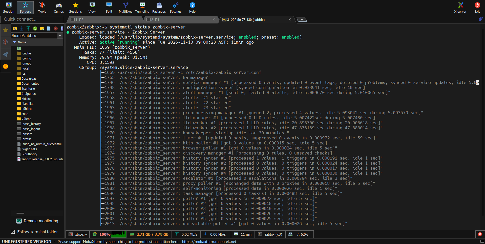

### 3.6 PC-USER: DHCP

```powershell
Set-NetIPInterface -InterfaceAlias "Ethernet" -Dhcp Enabled
Set-NetIPInterface -InterfaceAlias "Ethernet" -NlMtuBytes 1460
Rename-Computer -NewName "PC-USER" -Restart
ipconfig /renew
ipconfig /all
```

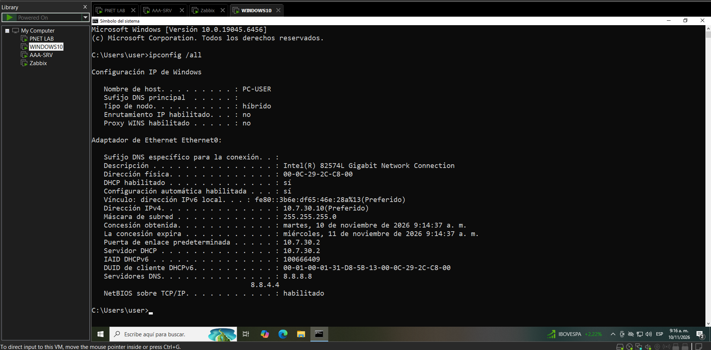

### 3.7 SNMP de solo lectura en el router

```bash
configure terminal

ip access-list standard SNMP-ZABBIX
 permit host 10.7.30.253
 deny any log
exit

snmp-server community zbx-ro-0730 RO SNMP-ZABBIX
snmp-server location Laboratorio-ITLA-2025-0730
snmp-server contact Arlene Fernandez Herrera

end
write memory
```

```bash
show snmp community
```

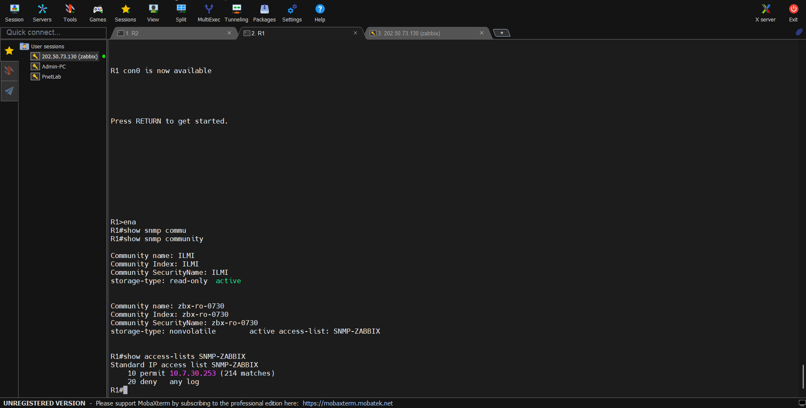

**Equipo `R1` en Zabbix:** `Recopilación de datos → Equipos → Crear equipo`

| Campo | Valor |
|---|---|
| Nombre de host | `R1` |
| Grupos | `Network devices` |
| Interfaz SNMP | `10.7.30.2`, puerto `161`, `SNMPv2`, comunidad `{$SNMP_COMMUNITY}` |
| Plantillas | `Cisco IOS by SNMP` |
| Macro `{$SNMP_COMMUNITY}` | `zbx-ro-0730` |

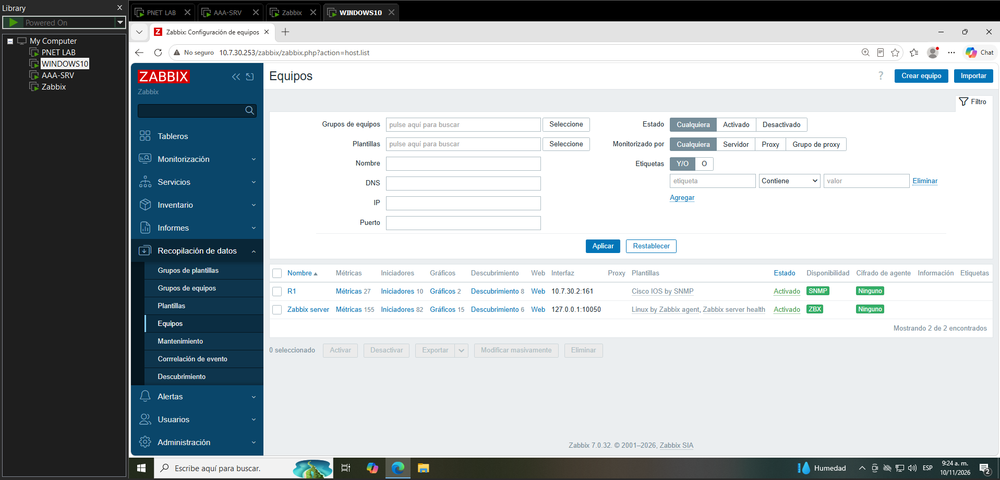

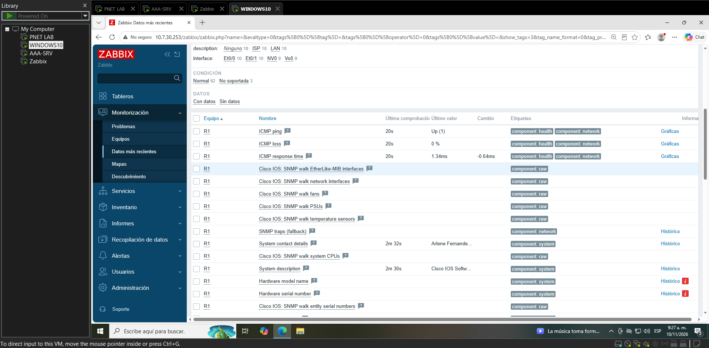

Verificación desde el servidor:

```bash
snmpwalk -v2c -c zbx-ro-0730 10.7.30.2 system
snmpset -v2c -c zbx-ro-0730 10.7.30.2 sysContact.0 s "prueba"
```

El `snmpwalk` devuelve los datos del sistema; el `snmpset` falla porque la comunidad es de solo lectura.

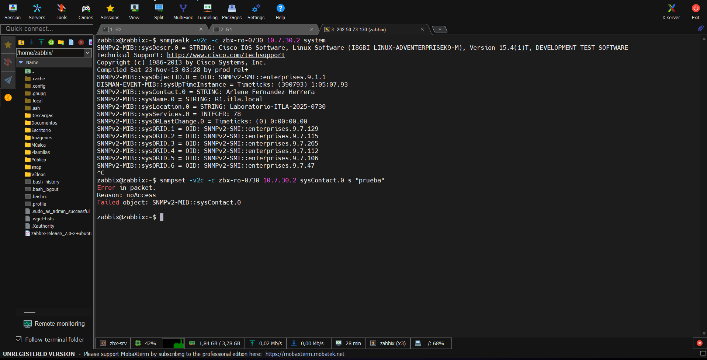

### 3.8 Usuario local y SSH (router y switch)

En el **router**:

```bash
configure terminal

username admin-local privilege 15 secret Admin-Local#2026
crypto key generate rsa modulus 2048
ip ssh version 2

ip access-list standard MGMT-SSH
 permit host 10.7.30.4
 permit host 10.7.30.253
 deny any log
exit

line vty 0 4
 loEn local
 transport input ssh
 access-class MGMT-SSH in
exit

end
write memory
```

En el **switch**:

```bash
configure terminal

username admin-local privilege 15 secret Admin-Local#2026
crypto key generate rsa modulus 2048
ip ssh version 2

line vty 0 4
 loEn local
 transport input ssh
exit

end
write memory
```

Verificación desde `AAA-SRV` (PowerShell):

```powershell
ssh -c aes256-cbc admin-local@10.7.30.2
ssh -c aes256-cbc admin-local@10.7.30.3
Test-NetConnection 10.7.30.2 -Port 23
```

En cada equipo, `show ip ssh` indica `SSH Enabled - version 2.0` y `show running-config | include username` muestra la contraseña como `secret`.

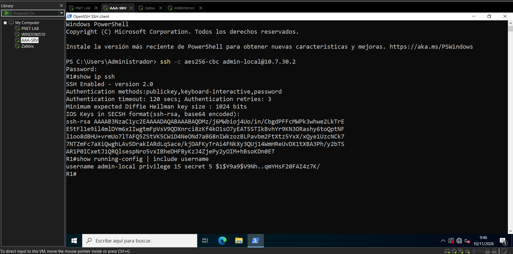

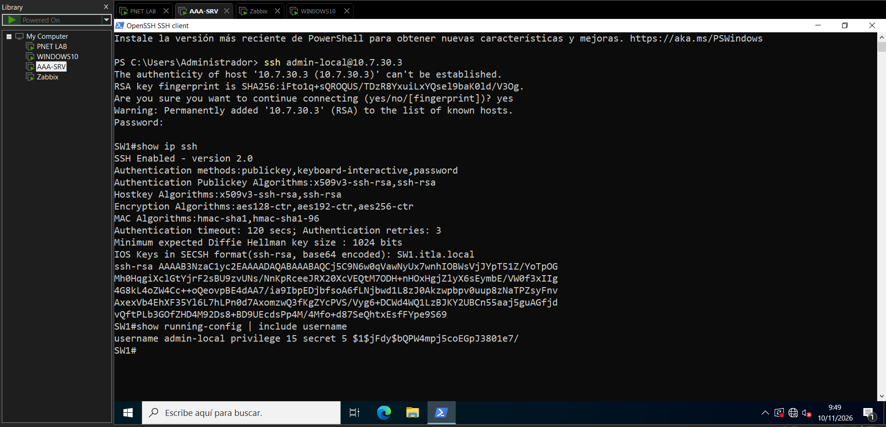

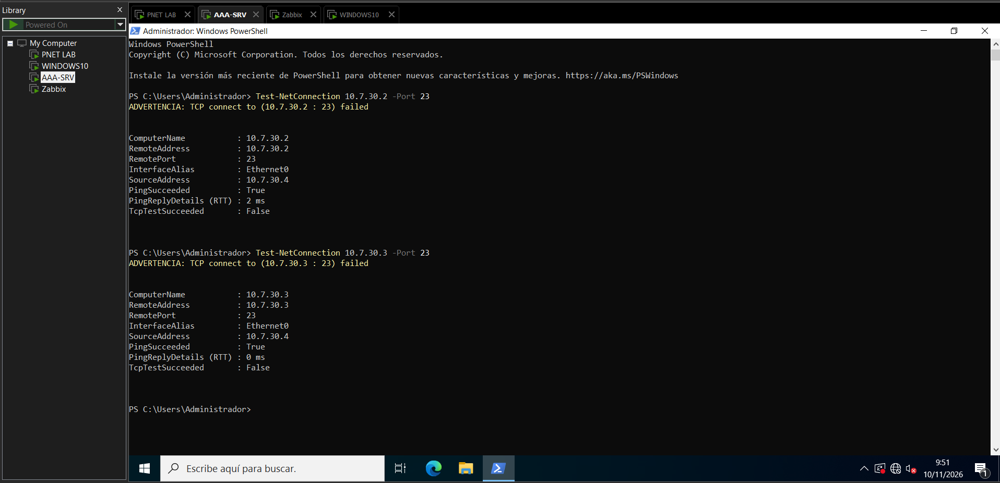

### 3.9 AAA, RADIUS y logs en el router

**Cliente RADIUS y prueba (antes de aplicarlo a las líneas):**

```bash
configure terminal

aaa new-model
aaa authentication loEn default local

radius server NPS
 address ipv4 10.7.30.4 auth-port 1812 acct-port 1813
 key R4dius-Rtr-2026!
 timeout 5
 retransmit 2
exit

aaa group server radius NPS-GROUP
 server name NPS
 ip radius source-interface EgabitEthernet0/0
exit

end
```

```bash
test aaa group NPS-GROUP user-admin Lab12345! new-code
```

Debe responder `User successfully authenticated`.

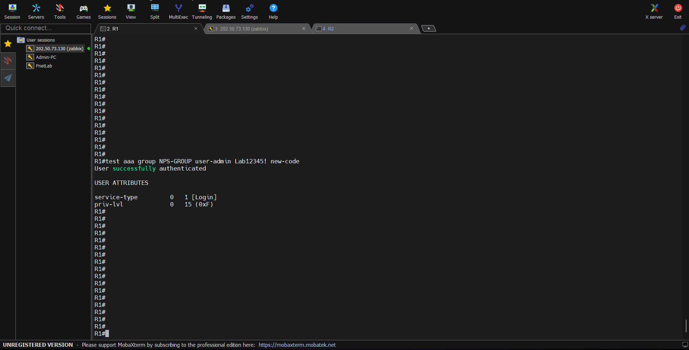

**Listas de métodos y líneas** (RADIUS en la consola, con respaldo local; SSH solo con usuario local):

```bash
configure terminal

aaa authentication loEn CON-AAA group NPS-GROUP local
aaa authentication loEn VTY-LOCAL local
aaa authentication enable default enable
aaa authorization console
aaa authorization exec CON-AAA group NPS-GROUP local
aaa authorization exec VTY-LOCAL local
aaa accounting exec CON-AAA start-stop group NPS-GROUP

enable secret Enable-Lab#2026

line con 0
 exec-timeout 5 0
 logEng synchronous
 loEn authentication CON-AAA
 authorization exec CON-AAA
 accounting exec CON-AAA
exit

line vty 0 4
 loEn authentication VTY-LOCAL
 authorization exec VTY-LOCAL
exit

service timestamps log datetime msec localtime show-timezone
service timestamps debug datetime msec localtime show-timezone
logEng buffered 64000 informational
loEn on-success log
loEn on-failure log
security authentication failure rate 3 log

end
write memory
```

**ReEstro de autenticación, autorización y RADIUS en vivo** (durante la demostración):

```bash
debug aaa authentication
debug aaa authorization
debug radius
```

Se apagan con `undebug all`.

**Demostración de acceso exitoso y fallido (consola de R1):**

1. Cerrar sesión e iniciar con `user-admin` y la contraseña correcta (`Lab12345!`): acceso concedido con nivel 15.
2. Cerrar sesión e iniciar con `user-admin` y una contraseña incorrecta: acceso rechazado.
3. Ver los reEstros:

```bash
show logEng
show aaa servers
```

En `show logEng` aparecen `%SEC_LOEN-5-LOEN_SUCCESS` y `%SEC_LOEN-4-LOEN_FAILED`. La salida de `debug radius` muestra `Access-Request` y `Access-Accept` / `Access-Reject`. En `AAA-SRV`, el Visor de eventos (`ReEstros de Windows → Seguridad`) muestra los eventos **6272** (acceso concedido) y **6273** (acceso denegado).

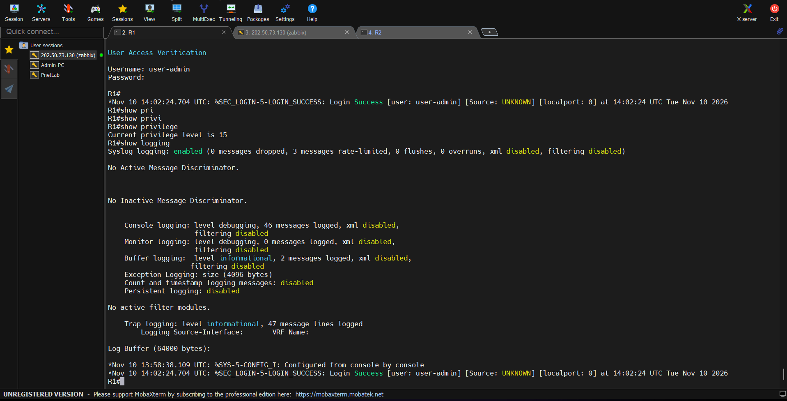

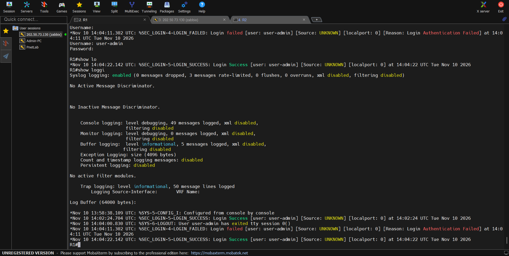

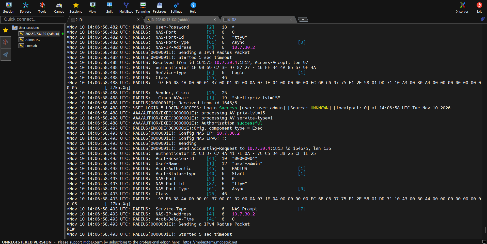

### 3.10 Script de hardening del switch

El script [`scripts/hardening_sw1.py`](scripts/hardening_sw1.py) se conecta por SSH a `SW1`, evalúa 10 reglas del CIS Benchmark de Cisco IOS, aplica las que no se cumplen, guarda la configuración y genera un informe posterior a la aplicación en `informes/`.

| ID | Regla | Comando clave |
|---|---|---|
| R01 | Cifrado de contraseñas | `service password-encryption` |
| R02 | `enable secret` robusto, sin `enable password` | `enable algorithm-type scrypt secret` |
| R03 | Banners de advertencia | `banner loEn`, `banner exec` |
| R04 | SSH v2, time-out y reintentos | `ip ssh version 2`, `ip ssh time-out 60`, `ip ssh authentication-retries 3` |
| R05 | VTY: solo SSH, inactividad y ACL de gestión | `transport input ssh`, `exec-timeout 5 0`, `access-class MGMT-SSH in` |
| R06 | Consola con tiempo de inactividad | `exec-timeout 5 0` |
| R07 | Servidor HTTP/HTTPS apagado | `no ip http server`, `no ip http secure-server` |
| R08 | ReEstro con marca de tiempo | `service timestamps log datetime ...`, `logEng buffered` |
| R09 | Servicios innecesarios apagados | `no service pad`, `no ip source-route`, `no ip bootp server`, `no cdp run` |
| R10 | Puertos sin uso apagados (complementaria) | `shutdown` |

Se ejecuta desde `ZBX-SRV`:

```bash
sudo apt install -y python3-venv python3-pip
python3 -m venv ~/hardening && source ~/hardening/bin/activate
pip install netmiko
python3 scripts/hardening_sw1.py
```

Pide el usuario, la contraseña y el nuevo `enable secret`. Al terminar imprime el informe y lo guarda en `informes/informe-posterior-<fecha-hora>.md`.

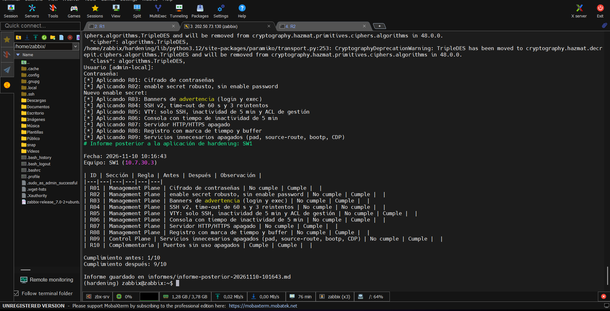

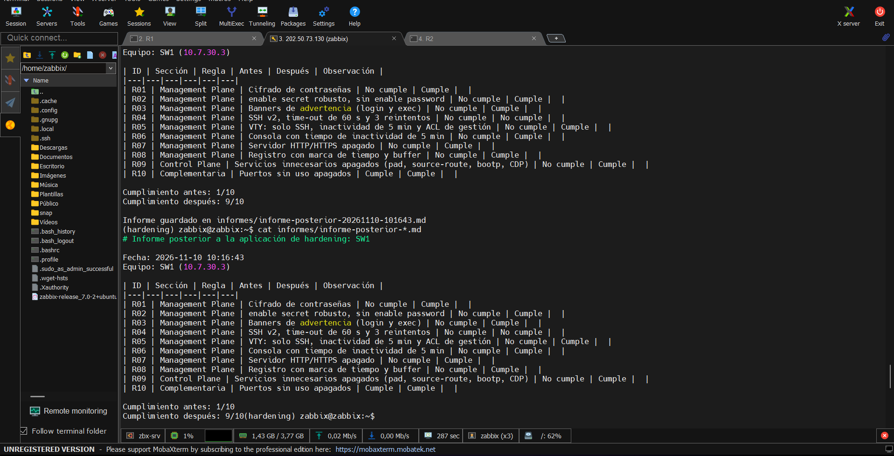

### 3.11 Conectividad y salida al ISP

**Conectividad entre los equipos de la LAN** (desde `R1`):

```bash
ping 10.7.30.3
ping 10.7.30.4
ping 10.7.30.253
```

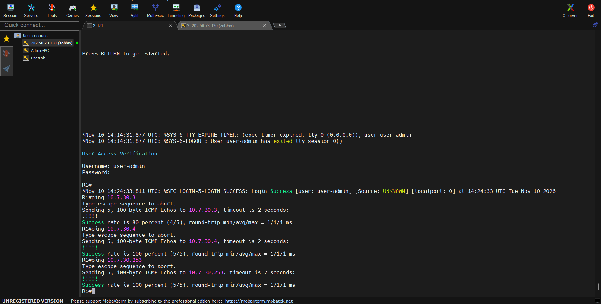

**Salida hacia el ISP desde el PC-USER:**

```powershell
ping 8.8.8.8
tracert 8.8.8.8
```

El primer salto es `10.7.30.2` (R1) y el segundo `202.50.73.2` (ISP). En el router:

```bash
show ip nat translations
```

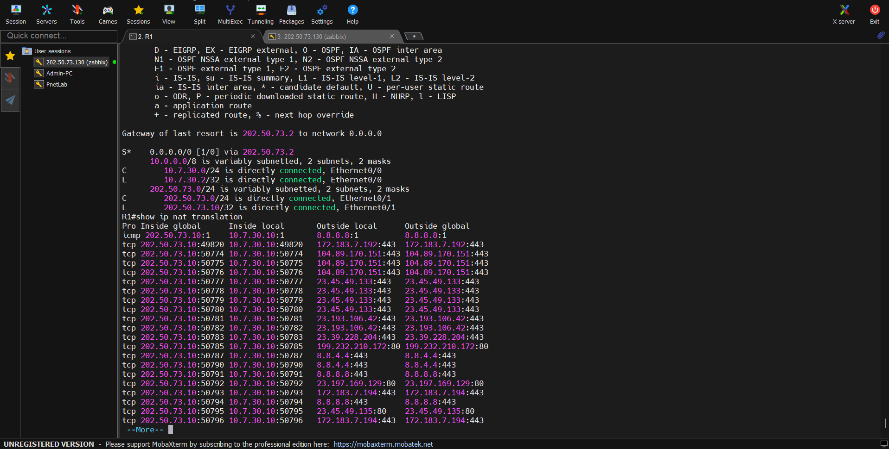

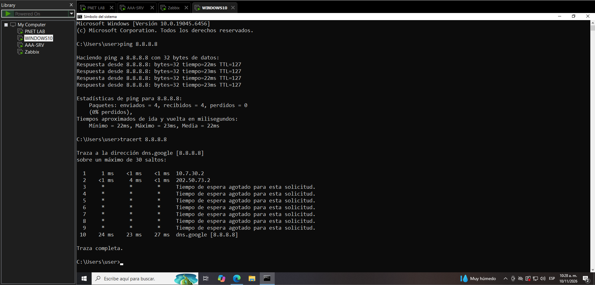

---

## 4. Cumplimiento de requisitos

| Requisito | Cómo se cumple | Sección |
|---|---|---|
| Direccionamiento, hostname y conectividad | Red `10.7.30.0/24`, hostnames `R1`, `SW1`, `AAA-SRV`, `ZBX-SRV`, `PC-USER` y pings entre los equipos | 2.1, 3.2, 3.3, 3.11 |
| Script de hardening del switch con informe posterior | `scripts/hardening_sw1.py`: 10 reglas CIS y `informes/informe-posterior-*.md` | 3.10 |
| DHCP en el router | Pool `LAN-POOL`; PC-USER y ZBX-SRV reciben IP por DHCP | 3.3, 3.5, 3.6 |
| SNMP de solo lectura en el router y datos en Zabbix | Comunidad `zbx-ro-0730 RO` y equipo `R1` con `Cisco IOS by SNMP` | 3.7 |
| Usuario local con contraseña cifrada y SSH sin Telnet | `username admin-local privilege 15 secret`, SSH v2 y `transport input ssh` en R1 y SW1 | 3.8 |
| Logs de AAA y RADIUS con acceso exitoso y fallido | `loEn on-success/on-failure log`, `debug aaa`, `debug radius`, eventos 6272 y 6273 en NPS | 3.9 |
| Repositorio organizado | `README.md`, un archivo de configuración por equipo e `imagenes/` | 5 |
| Ruta por defecto y NAT con ping y traceroute | `ip route 0.0.0.0 0.0.0.0 202.50.73.2` y `ip nat inside source ... overload` | 3.3, 3.11 |

---

## 5. Estructura del repositorio

```
/
├── README.md
├── imagenes/                  ← diagrama y evidencias numeradas
├── configuraciones/
│   ├── r1-running-config.txt
│   └── sw1-running-config.txt
├── scripts/
│   ├── hardening_sw1.py
│   └── zabbix-instalacion.sh
└── informes/
    └── informe-posterior-<fecha-hora>.md
```
